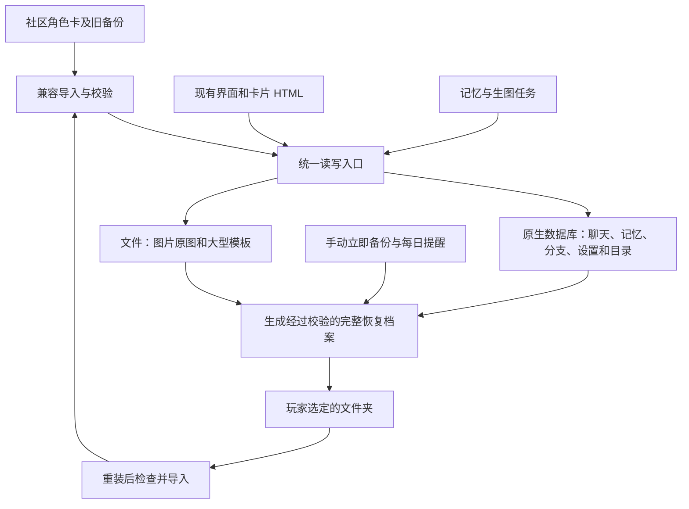

# 存储改造路线

日期：2026-11-08。当前实施阶段：2.9.010 的保存检查与导入整理。

## 给使用者的说明

Gradle 是安卓项目的自动装配工具，负责把源码、依赖和资源编译成安装包，并组织测试。Gradle 工程是能按这套规则直接构建的源码项目。它不是数据库，也不会自行解决卡顿和丢档。

目前项目用 Apktool 维护已有安卓壳，另有可编辑的 Java 文件。下一步单独建立标准安卓工程，才能逐步接入、测试和维护 Room 等原生能力。Room 管理底层 SQLite 数据库；保存是否可靠仍取决于提交、错误处理、备份和恢复设计。

## 已经落实的第一步

- 数据备份页只保留一个“导入备份”入口，识别 JSON 和 ZIP。JSON 继续后台逐段读取，保留三个读取档位及现有限制。
- 修正保存等待的误判：一个项目写入失败后，等待队列也会失败；其他项目保存成功不能掩盖它，对应项目重试成功才清除。
- 复用现有写入队列，只增加按保存项目记录的未解决错误。普通记录的保存与删除共用同一项目标识，图片、同步标记分别记录。
- 手动导出、静默保存、每日提醒和社区角色卡格式继续保留。界面使用现有两套布局，未替换 RP 运行逻辑。

当前仍使用 IndexedDB 主库、localStorage 偏好、本地 JSON 副本及独立图片。第一步没有接入 Room，也没有实现新的完整存档格式。

## 最终职责划分

运行中的数据库负责日常读写；文件夹中的完整档案负责救援和搬家。两者有明确用途，不允许两套数据库长期同时充当主数据。

角色库先读轻量目录，进入一张卡才读它的正文、世界书、聊天和模板。图片按需读取。旧聊天分页显示。兼容单面板的卡可以只挂载一个面板并更新状态；不兼容的卡保留原有行为，不强制改变作者的 HTML、正则和状态协议。

记忆与生图任务记录所属角色、分支、来源消息和数据版本。任务完成时再次核对，切卡、删消息或恢复旧档后，过期任务不能覆盖当前记录。重试与并发数量由任务管理统一控制。

## 第二步：补齐现有恢复缺口

1. 文件索引损坏时保留坏文件，明确报错，再从完整主库或已确认完整的档案恢复；不能当空库静默覆盖。
2. 一组有关联的文件使用完成标记和版本清单，未全部完成的版本不能参与恢复，避免拼接新旧数据。
3. 完整档案纳入独立图片目录及个人设置，清单记录格式版本、大小、校验值和媒体引用。保留原 JSON 社区兼容导入导出。
4. 手动备份和自动备份使用同一套生成、校验和完成流程。只有完整写入且检查通过才更新“最后成功备份时间”。

不能直接取消现在的导入内存限制：逐段读取后，最终提交仍会组装集合。真正降低大存档峰值内存，需要继续改提交方式及媒体存储。

## 第三步：独立验证标准安卓工程

创建独立目录及测试包名，例如 `com.rphub.local.storage_lab`。优先复用现有 Java 文件与网页资源，不同时更换界面、开发语言和卡片引擎。当前正式安装包仍沿用既有构建流程。

实验范围：

- 使用 Gradle 从完整源码构建；固定依赖版本，提供可重复的构建和测试命令。
- Room 先验证角色目录、一张卡、聊天、分支、记忆、设置和任务记录；大图片及模板正文独立存文件。
- 通过一个统一接口接到网页，逐步替换内部存储实现，保留外部卡片和旧备份格式。
- 一次只迁移一份隔离数据副本；旧数据保留。迁移成功后选定新库为唯一主库，失败仍能回到旧版本。
- 真实旧档在本机隔离环境验证，不提交进源码或上传。

这里的验收结果决定是否迁移正式软件。如果桥接性能或旧卡兼容未达标，继续沿用现有网页运行层，只把经过验证的存储能力迁入原生层。

## 玩家能够自己取走的档案

目标流程：首次选择一个玩家能访问的文件夹，软件持续更新其中已完成的恢复档案。软件无法打开时，玩家用系统文件管理器复制整个档案目录，再重装并导入。旧完整版本在新版本检查通过前保留。

安卓应用私有目录、应用专属外部目录和玩家选择的共享文件夹不是同一回事。不能把显示出文件路径当作玩家一定能复制的证明。当前版本仍未保证上述救援流程成立。

数据库运行文件放在应用管理的位置；救援档案写入玩家授权选择的目录。导出数据库时使用一致性快照，不能在运行中只复制单个数据库文件、遗漏尚未合并的写入日志。媒体增量复制并按清单引用，避免每回合重复复制全部原图。

完整档案至少包含角色内容、聊天、分支、记忆、界面状态、预设、全局配置、个人设置和图片原文件；缺少媒体时明确列出，不能当完整成功。

## 正式切换前必须通过

| 检查 | 通过条件 |
| --- | --- |
| 保存时结束进程 | 重开只能得到完整旧版或完整新版，不混用 |
| 空间不足、授权被撤销 | 明确失败，旧档案仍可读，成功时间不更新 |
| 导入坏文件、中途取消、进程中断 | 当前存档保留，暂存内容可丢弃或恢复 |
| 坏索引、丢图片、内容被截断 | 可定位并报告，不能静默覆盖正常内容 |
| 切卡与后台任务完成同时发生 | 结果只写回原角色、原分支及有效版本 |
| 软件无法打开后的人工救援 | 真机文件管理器能复制档案，重装后能导入 |
| 空白环境恢复 | 角色、聊天、记忆、设置、图片及引用逐项一致 |
| 大存档与长时间游玩 | 记录安卓设备型号、启动耗时、内存、保存耗时和温升；与现版同档对比 |

## 本次验证入口

- `scripts/test-storage.cjs`：写入失败、等待失败、无关写入不清除失败、记录/删除/同步标记/图片重试，以及旧库迁移和文件恢复。另用 `--legacy-bridge` 检查旧文件接口。
- `scripts/test-stream-import.cjs`：两套布局的单一入口、JSON/ZIP 实际导入、取消、失败回退、中断恢复及手机/桌面尺寸。
- `scripts/test-suite.cjs`：项目现有完整回归，包含备份提醒、聊天、记忆、分支和图片等。
- `scripts/check-apk.py`：版本、同签名、原生类与网页资源一致性。

桌面浏览器和模拟文件接口的结果，不能替代安卓真机进程中断、目录授权、磁盘写入和重装恢复验证。本次不会将单面板实验环境视为正式软件实现。

## 2.9.010 实际结果

- 新回归在修改前复现保存等待误判，修正后新旧文件接口均通过；记录、删除、同步标记、图片分别验证失败保留及重试解除。
- 最终完整回归 45/45 通过，报告为 `verification/alignment-1.23/suite/results.json`。首轮发现公告未写皮肤入口准确名称，补回“外观”后重新运行整套检查通过。
- 两套布局及日夜配色的备份页截图位于 `.impeccable/review/backup-2.9.005/backup-options-*.png`；沿用原验证目录名。检查过两套布局的手机截图，并核对无横向溢出。
- `dist/RP-local-2.9.010.apk` 已本地构建，versionCode 为 274；185 个网页文件和 5 个尺寸图标核对通过，无打包字体或重复资源。同旧本地版签名，签名及对齐验证通过。
- 安装包 7,499,359 字节，与本机保留的 2.9.009 大小相同；SHA-256 为 `ac76648d39e379916acf57eaabf8678b9c77e2e9bc92836404776e38155426d4`。
- 未上传发布页，未在手机上安装，未修改玩家真实存档。标准 Gradle 工程和 Room 迁移仍属于后续阶段。
